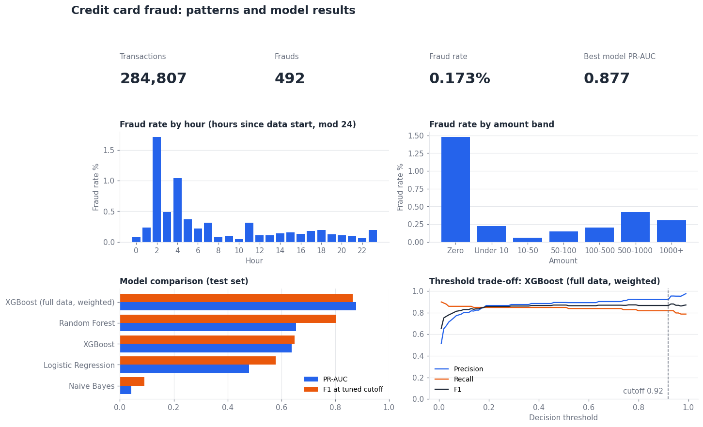

# Credit Card Fraud Detection: A Hands-On Project

> **Original project by [Nhi Yen](https://github.com/yennhi95zz)** ([Kaggle notebook](https://www.kaggle.com/nhiyen/code), [Medium](https://medium.com/@yennhi95zz)). This fork by **Malik Huzaifa** keeps her notebook as it was and adds SQL analysis, a dashboard, more models and threshold tuning. Everything below "Original project" is her write-up.

## What Malik Huzaifa added

| Addition | Where |
|---|---|
| MySQL analysis: the data loaded into MySQL 8.4, with queries for fraud rate by amount band, hour of day, quiet vs busy hours, day, amount profile and the most telling features | [`sql/`](sql/), output in [`results/sql/query_results.txt`](results/sql/query_results.txt) |
| More models: XGBoost added next to Logistic Regression, Naive Bayes and Random Forest, plus an XGBoost trained on the full data with class weighting, all in one results table | [`src/models.py`](src/models.py), [`results/model_comparison.csv`](results/model_comparison.csv) |
| Threshold tuning: the cutoff is picked on the validation set for the best F1, then tested once on the held-out test set. Reports precision, recall, F1, ROC-AUC and PR-AUC | [`results/threshold_tradeoff.png`](results/threshold_tradeoff.png), [`results/pr_curves.png`](results/pr_curves.png) |
| Dashboard: tables ready for Power BI, a build guide, and a preview of the layout | [`powerbi/`](powerbi/), [`src/dashboard.py`](src/dashboard.py) |

## Results

### Fraud patterns (SQL)

- **0.173%** of 284,807 transactions are fraud (492).
- **Quiet hours are riskier.** Hours 0-6 have a fraud rate of 0.474%, which is 3.4× the 0.140% of busy hours. Hour 2 peaks at 1.71%.
- **Zero-amount transactions** have a fraud rate of 1.48%, about 8.5× the average. These are likely card checks before larger fraud.
- **Mid-size amounts (10-50)** are the safest band, at 0.061%.
- Fraud averages **122.21** per transaction against 88.29 for normal ones, but the largest fraud is only 2,125.87.
- V14, V17, V12 and V10 separate fraud the most (fraud means of about -6 to -7, normal means of about 0).

The dataset has no real clock time. "Hour" counts hours since the first transaction, mod 24.

### Models (held-out test set: 56,962 transactions, 98 frauds)

| Model | ROC-AUC | PR-AUC | F1 at 0.5 | Tuned cutoff | Precision | Recall | F1 | Caught | Missed | False alarms |
|---|---|---|---|---|---|---|---|---|---|---|
| Dummy | 0.500 | 0.002 | 0.003 | 0.5000 | 0.002 | 1.000 | 0.003 | 98 | 0 | 56,864 |
| Logistic Regression | 0.970 | 0.480 | 0.067 | ≈1.000 | 0.493 | 0.704 | 0.580 | 69 | 29 | 71 |
| Naive Bayes | 0.954 | 0.043 | 0.057 | ≈1.000 | 0.048 | 0.816 | 0.091 | 80 | 18 | 1,575 |
| Random Forest | 0.973 | 0.654 | 0.156 | 0.8204 | 0.761 | 0.847 | 0.802 | 83 | 15 | 26 |
| XGBoost | 0.968 | 0.638 | 0.079 | 0.9985 | 0.569 | 0.755 | 0.649 | 74 | 24 | 56 |
| **XGBoost (full data, weighted)** | **0.976** | **0.877** | **0.869** | **0.9185** | **0.919** | **0.816** | **0.865** | **80** | **18** | **7** |

What this shows:

- **ROC-AUC hides the difference.** Every real model scores 0.95-0.98 on ROC-AUC, but PR-AUC ranges from 0.04 to 0.88. With 0.17% fraud, PR-AUC is the honest measure.
- **The default 0.5 cutoff fails for models trained on undersampled data.** They see 50/50 classes in training, so at 0.5 they flag thousands of normal payments. Tuning the cutoff lifts Random Forest from an F1 of 0.16 to 0.80.
- **Best model: XGBoost on the full training data with class weighting.** At the tuned cutoff it catches 80 of 98 frauds with only 7 false alarms in almost 57,000 transactions. That is about 1 false alarm per 8,000 payments, against 26 for the tuned Random Forest.
- **Trade-off:** Random Forest catches 3 more frauds (83 vs 80) but raises almost 4× the false alarms. Choose XGBoost when review cost matters and Random Forest when every missed fraud is expensive.

### Dashboard



*Preview drawn in Python from the same tables. To build it in Power BI, see [`powerbi/README.md`](powerbi/README.md).*

## Run it

1. Download `creditcard.csv` from [Kaggle](https://www.kaggle.com/datasets/mlg-ulb/creditcardfraud) into `data/`. It isn't committed because it's 150 MB.
2. `pip install -r requirements.txt`
3. `python src/models.py`, then `python src/dashboard.py`
4. MySQL: from the repo root, run `mysql --local-infile=1 -u root < sql/01_create_and_load.sql`, then `mysql -u root < sql/02_fraud_analysis.sql`

---

# Original project

This project aims to create a model to detect fraudulent transactions in credit card transactions.

## Getting Started
### Prerequisites
- Python 3.x
- Libraries: pandas, numpy, matplotlib, seaborn, sklearn, scipy, imblearn

### Installation
- Clone the repository
```
git clone https://github.com/username/project.git
```
- Install required libraries
```
pip install pandas numpy matplotlib seaborn sklearn scipy imblearn
```

## Usage
Run the following command in the terminal to execute the project:
```
python main.py
```

## Overview of the Code

### 1. Exploratory Data Analysis

- Loading data
- Printing random sample of 10 rows to check data loading
- Printing data overview
- Printing numerical summary for Time and Amount columns
- Plotting distribution of Time feature
- Plotting distribution of Amount feature
- Counting number of fraud vs non-fraud transactions and displaying them with their ratio
- Plotting count of fraud vs non-fraud transactions in a bar chart

### 2. Data Processing

- Plotting heatmap to find any high correlations between variables

### 3. Modeling

- Drop the 'Class' column to prepare data for splitting
- Get the target variable
- Split data into training, validation and test sets, ensuring the class distribution is maintained
- Initialize the `StandardScaler` object and fit it to the training data
- Scale the training, validation, and test sets using the scaler
- `Undersampling` will be utilized to address the issue of imbalanced classes.

## Modeling Techniques

### 1. Logistic Regression

- Run CV with 5 folds (logit)
- Instantiate RandomUnderSampler

### 2. Naive Bayes
- Fit a Naive Bayes Model

## References
- Kaggle Dataset: [Credit Card Fraud Detection](https://www.kaggle.com/datasets/mlg-ulb/creditcardfraud)
- Github Repo - [HERE](https://github.com/yennhi95zz/credit-card-fraud-detection-a-hands-on-project)
- Kaggle Project - [HERE](https://www.kaggle.com/nhiyen/credit-card-fraud-detection-a-hands-on-project)
- Detail Explanation about the code on [MEDIUM](https://medium.com/@yennhi95zz/credit-card-fraud-detection-a-hands-on-project-760cad61b1da)

## License
This project is licensed under the MIT License.
